# Catering IS

Java application for managing catering projects: project folders, documents, menus with revisions, sharing a menu with a customer through a link, customer comments, PDF export and user administration. The desktop client (JavaFX) is for staff. A small web server (JDK `HttpServer`) serves the customer page `/menu/<token>` and a read only manager overview `/manager`. Data are stored in Oracle (JDBC with hand written Data Mappers) and documents in a folder on disk. No frameworks or ORMs are used.

## Requirements

- JDK 21 or newer
- Maven 3.9
- Oracle Database 19c or newer. For local development Oracle Database Free in Docker works (image `gvenzl/oracle-free`, service name `FREEPDB1`).
- A display for the desktop client and for the JavaFX tests (those tests are skipped without one)

## Database server

The application needs an Oracle database (19c or newer) with the schema user that owns the tables. Two setups are used. Only the three `db.*` keys in `config/db.properties` change between them: `db.url`, `db.user` and `db.password`.

Placeholders like `<SYS password>` stand for your own values. Never commit real passwords.

### A) Local Oracle in Docker (development)

This is the setup used during development: Oracle Database 23ai Free in Docker, container `vis-oracle`, pluggable database `FREEPDB1`, schema user `CATERING`.

| Setting | Value |
|---|---|
| Image | `gvenzl/oracle-free:23.7-slim` |
| Container | `vis-oracle` (restart policy `unless-stopped`) |
| Data volume | `vis-oracle-data` mounted at `/opt/oracle/oradata` |
| Host / port | `localhost` / `1521` |
| Service name | `FREEPDB1` |

**First start.** This creates the container, the database and the `CATERING` user in one step. The image creates `APP_USER` with its password automatically.

```bash
docker run -d --name vis-oracle -p 1521:1521 \
  -v vis-oracle-data:/opt/oracle/oradata \
  -e ORACLE_PASSWORD=<SYS password> \
  -e APP_USER=CATERING -e APP_USER_PASSWORD=<CATERING password> \
  --restart unless-stopped gvenzl/oracle-free:23.7-slim
docker logs -f vis-oracle      # wait for "DATABASE IS READY TO USE!"
```

If the container already exists without the user, create it as SYSTEM:

```bash
docker exec -i vis-oracle sqlplus -s system/<SYS password>@//localhost:1521/FREEPDB1 <<'SQL'
CREATE USER catering IDENTIFIED BY "<CATERING password>" QUOTA UNLIMITED ON users;
GRANT CREATE SESSION, CREATE TABLE, CREATE SEQUENCE, CREATE TRIGGER, CREATE VIEW,
      CREATE PROCEDURE, CREATE SYNONYM TO catering;
SQL
```

**Everyday commands**

```bash
docker start vis-oracle        # start (after a reboot)
docker stop vis-oracle         # stop
docker ps --filter name=vis-oracle   # status
docker logs -f vis-oracle      # log, ready when "DATABASE IS READY TO USE!" appears
docker exec -it vis-oracle sqlplus CATERING/<CATERING password>@//localhost:1521/FREEPDB1
```

On Linux with Docker Desktop, start it first with `systemctl --user start docker-desktop`. The CLI context is `desktop-linux`.

**Create the schema and data** with sqlplus inside the container (run from the folder with the scripts):

```bash
for f in 01_schema.sql 02_seed.sql 03_checks.sql 04_queries.sql; do docker cp "$f" vis-oracle:/tmp/; done
printf 'SET SERVEROUTPUT ON\n@/tmp/01_schema.sql\n@/tmp/02_seed.sql\n@/tmp/03_checks.sql\nexit\n' \
  | docker exec -i vis-oracle sqlplus -S CATERING/<CATERING password>@//localhost:1521/FREEPDB1
```

`01_schema.sql` drops and recreates its own objects, so running 01 → 02 again resets the data. `04_queries.sql` is the query catalogue and is optional for the application.

The SQL Developer alternative: create a new connection with user `CATERING`, host `localhost`, port `1521` and service name `FREEPDB1`. Open each script and run it with F5 (Run Script).

**Reset everything** (deletes all data):

```bash
docker rm -f vis-oracle && docker volume rm vis-oracle-data
```

Then run the first-start command again.

**`config/db.properties`**

```properties
db.url=jdbc:oracle:thin:@//localhost:1521/FREEPDB1
db.user=CATERING
db.password=<CATERING password>
```

### B) University server dbsys.cs.vsb.cz

The final database runs on the school Oracle server. You use your own school schema there, so there is no Docker and no user creation.

| Setting | Value |
|---|---|
| Host | `dbsys.cs.vsb.cz` |
| Port | `1521` `<to confirm>` |
| Service name | `<to confirm>` (ask the teacher or take it from your SQL Developer connection) |
| User | `<login>` (your school login) |
| Password | `<password>` (your school database password) |

The server is reachable from the university network. From home, connect to the VŠB VPN first `<to confirm>`.

**SQL Developer:** create a new connection with the user `<login>`, the password, host `dbsys.cs.vsb.cz`, port `1521` and the service name above. Use "Test" to check it, then "Save" and "Connect". Open `01_schema.sql`, `02_seed.sql`, `03_checks.sql` and `04_queries.sql` in this order and run each with F5 (Run Script). The assignment requires SQL Developer for work with the school database.

**sqlplus** (if installed on your machine):

```bash
sqlplus <login>/<password>@//dbsys.cs.vsb.cz:1521/<service name>
SQL> SET SERVEROUTPUT ON
SQL> @01_schema.sql
SQL> @02_seed.sql
SQL> @03_checks.sql
SQL> @04_queries.sql
```

**Privileges.** The schema needs CREATE TABLE, SEQUENCE, TRIGGER and VIEW. Two blocks in `04_queries.sql` need more and are commented out:
- the external table (SQL S08: `CREATE DIRECTORY` plus `ORGANIZATION EXTERNAL ... ORACLE_LOADER`)
- `CREATE PUBLIC SYNONYM`

Enable them only if your school account has `CREATE ANY DIRECTORY` / `CREATE PUBLIC SYNONYM`. The external table also needs the CSV file on the database server.

**`config/db.properties`**

```properties
db.url=jdbc:oracle:thin:@//dbsys.cs.vsb.cz:1521/<service name>
db.user=<login>
db.password=<password>
```

## Database scripts

The scripts are in the TDS part of the project. In the hand-in zip they are copied to `db/`. Run them as the application schema user (for example `CATERING`), in this order:

1. `db/01_schema.sql` creates tables, constraints, triggers and indexes.
2. `db/02_seed.sql` loads the test data (10 projects, 77 nodes, 10 users, 12 menus).
3. Optional: `db/03_checks.sql` (integrity checks and rejection tests) and `db/04_queries.sql` (example queries).

## Configuration

Copy `config/db.properties.example` to `config/db.properties` and fill in your values. The real file is not committed.

| Key | Meaning |
|---|---|
| `db.url` | JDBC URL, for example `jdbc:oracle:thin:@//localhost:1521/FREEPDB1` |
| `db.user` | Database schema user |
| `db.password` | Password of that user |
| `documents.dir` | Folder of the document storage (second storage, files on disk), default `./documents` |
| `web.port` | Port of the customer web server, default `8080` |
| `web.baseUrl` | Public base URL used to build share links, default `http://localhost:8080` |
| `web.embedded` | `true` starts the customer web server and the share link expiry scheduler inside the desktop app (demo on one machine). `false` (default) means they run only in the separate web process (`WebMain`). |

## Build and run

```
mvn clean test         # compile and run all 330 tests
mvn javafx:run         # desktop client (DesktopApp)
mvn exec:java          # web server only (WebMain), no desktop
```

With `web.embedded=true` the desktop client also serves the web pages. URLs:

- `http://localhost:8080/menu/<token>` customer page for a shared menu. The token is in the share link created in the desktop client.
- `http://localhost:8080/manager` manager overview (read only, login required).

## Demo accounts

Loaded by `02_seed.sql`. Roles are additive and the rules are in `AccessPolicy`. W is worker (desktop client), A is administrator (admin mode, user management), M is manager (web `/manager`, sees only projects of the workers who report to them).

| User | Roles | Note |
|---|---|---|
| `jzamostny` | W + A | main demo worker, owns the project "Svatba Novákovi" |
| `kpokorny` | W + A | |
| `mkral` | A + M | opens user management directly, manages `jzamostny` |
| `tsvoboda` | M | manager only, uses the web overview |
| `ehorakova`, `mdvorakova` | M | |
| `pnovak`, `lcerna`, `avesela` | W | |
| `jbenes` | W | inactive account |

The password of every seed account is `heslo123`. It is a test value. Change it in production.

## Tests

`mvn clean test` runs 330 tests (JUnit 5). They need the seeded Oracle database. Tests that touch it create their own data and delete it afterwards.

| Group | Tests |
|---|---|
| `business.domain` unit tests | 75 |
| `business.command` | 8 |
| `business.service` (fake mappers, Service Stub storage) | 107 |
| `business.e2e` use case tests on Oracle | 55 |
| `data.file`, `data.oracle` | 26 |
| `presentation.desktop` (real JavaFX windows) | 33 |
| `presentation.web` (real HTTP) | 25 |
| `AppContextTest` | 1 |

## Structure

```
presentation.{desktop,web}  ->  business.{domain,command,pricing,port,service}  <-  data.{oracle,file}
                                  AppContext = composition root
```

| Package | Responsibility |
|---|---|
| `cz.vsb.catering` | `AppContext`, reads the config and wires everything |
| `presentation.desktop` | JavaFX windows and dialogs, `DesktopApp` |
| `presentation.web` | JDK `HttpServer`: customer page, manager overview, `ExpiredLinkScheduler`, `WebMain` |
| `business.domain` | entities, value objects, business rules, `AccessPolicy` |
| `business.command` | undoable menu edits (`MenuEditor`, `*Command`) |
| `business.pricing` | price strategies with and without VAT |
| `business.port` | interfaces the business layer needs (mappers, `DocumentStorage`, `TransactionRunner`, `MenuDocumentRenderer`) |
| `business.service` | services, one operation per use case step |
| `data` | `DataAccessFactory` |
| `data.oracle` | `Database`, `Jdbc` helper, `Oracle*Mapper` classes |
| `data.file` | `FileDocumentStorage`, `InMemoryDocumentStorage`, `PdfMenuRenderer` |

## Class diagrams

Generated from the sources by `python3 tools/class-diagram.py` (run in this folder, needs Java and `/usr/share/plantuml/plantuml.jar`). The script writes the `.puml` files and renders `.png` and `.svg` next to them, also for the pattern diagrams. Open the SVG files for a zoomable version.

- [All classes](docs/diagrams/class-diagram.svg), grouped by layer and package (inheritance and associations, members hidden; associations into `business.domain` from other packages and the wiring in `AppContext` are left out to keep it readable)
- [Presentation layer](docs/diagrams/class-diagram-presentation.svg)
- [Business layer](docs/diagrams/class-diagram-business.svg)
- [Data layer](docs/diagrams/class-diagram-data.svg)

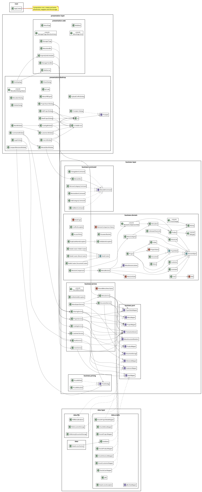

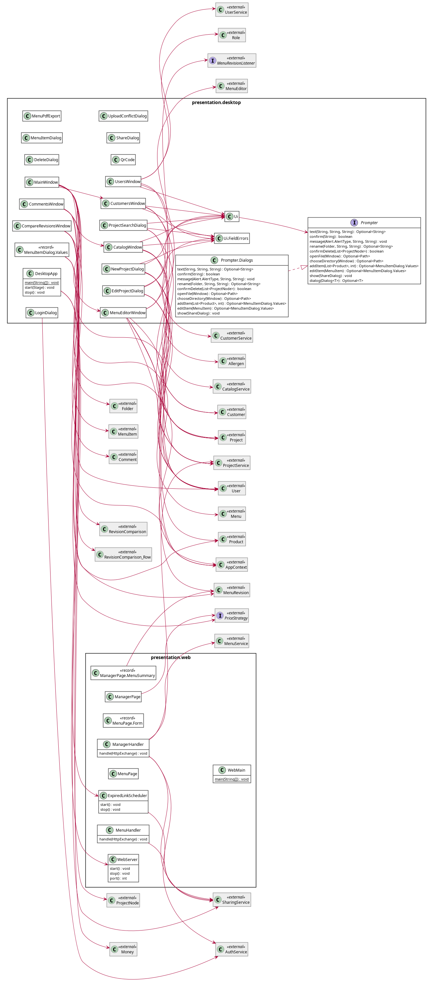

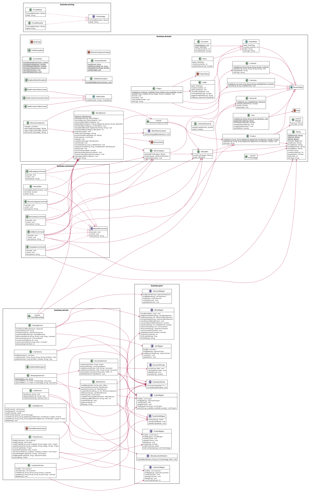

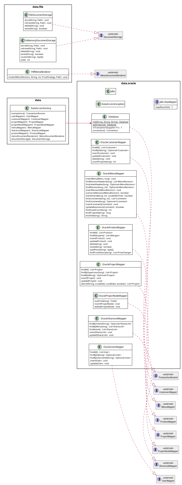

## Design patterns

17 enterprise patterns (Fowler, PoEAA) and 8 GoF patterns. Each one is in the code, the table gives the main classes and the sections below give every role with the diagrams (textbook structure on the left, this code on the right).

| Pattern | Source | Main classes |
|---|---|---|
| Layers | Fowler, PoEAA | presentation.desktop, presentation.web, business.domain, command, pricing, port, service, data.oracle, data.file, data.DataAccessFactory |
| Domain Model | Fowler, PoEAA | MenuRevision, Project, Customer, User, Product, ShareLink, AccessPolicy, MenuService, ProjectService |
| Layer Supertype | Fowler, PoEAA | DomainObject, ProjectNode, Project, Customer, User, Product, Comment, ShareLink, MenuCategory |
| Value Object | Fowler, PoEAA | Money, MenuItem, Product, PriceStrategy implementations |
| Service Layer | Fowler, PoEAA | MenuService, SharingService, ProjectService, DocumentService, AuthService, UserService, CustomerService, CatalogService, MenuExportService, windows in presentation.desktop, handlers in presentation.web |
| Data Mapper | Fowler, PoEAA | Project, MenuRevision, User, ..., business.port.*Mapper, data.oracle.Oracle*Mapper |
| Identity Field | Fowler, PoEAA | DomainObject.id, Jdbc.insert, Oracle*Mapper.insert |
| Foreign Key Mapping | Fowler, PoEAA | Project, MenuItem, Customer, Product, OracleProjectMapper, OracleMenuMapper |
| Association Table Mapping | Fowler, PoEAA | User and Role, Product and Allergen, user_roles, product_allergens, OracleUserMapper, OracleProductMapper |
| Dependent Mapping | Fowler, PoEAA | MenuRevision, MenuCategory, MenuItem, OracleMenuMapper (insertContent) |
| Single Table Inheritance | Fowler, PoEAA | ProjectNode, Folder, Document, Menu, project_nodes.node_type |
| Lazy Load | Fowler, PoEAA | MenuRevision (commentLoader), OracleMenuMapper.findComments, ProductMapper.loadPhoto |
| Gateway | Fowler, PoEAA | DocumentStorage, FileDocumentStorage, DocumentService |
| Service Stub | Fowler, PoEAA | DocumentStorage, InMemoryDocumentStorage, DocumentServiceTest, MenuExportServiceTest |
| Special Case | Fowler, PoEAA | ShareLink, UnknownShareLink, SharingService |
| Optimistic Offline Lock (simplified) | Fowler, PoEAA | MenuRevision.getLoadedSavedAt (time of the last save), OracleMenuMapper.overwriteRevision, markShared, ConflictException, thrown by MenuService |
| Transaction | Fowler, PoEAA | TransactionRunner, Database.inTransaction, all *Service classes |
| Composite | GoF | ProjectNode, Document, Menu, Folder |
| Factory | GoF | DataAccessFactory, port interfaces (MenuMapper, DocumentStorage, ...), Oracle*Mapper, FileDocumentStorage, PdfMenuRenderer |
| Factory Method | GoF | NodeCreator (createIn), FolderCreator, MenuCreator, DocumentCreator, ProjectNode |
| Singleton | GoF | Database, Database.init, Database.getInstance (Jdbc, OracleMenuMapper) |
| Facade | GoF | MenuService (and the other *Service classes), MenuMapper, ProjectNodeMapper, TransactionRunner, domain objects, MenuEditorWindow |
| Strategy | GoF | MenuItem (price), PriceStrategy, PriceWithoutVat, PriceWithVat |
| Observer | GoF | MenuRevision, MenuRevisionListener, MenuEditorWindow (listener lambda) |
| Command | GoF | MenuEditorWindow, MenuEditor, MenuEditCommand |

### Layers

Source: Fowler, PoEAA. The whole application. Presentation calls only services, the business layer depends on interfaces in business.port and never on the data layer, so the storage can be replaced (Oracle mappers in production, fakes in tests).

| Role | Class in the code |
|---|---|
| Presentation | presentation.desktop, presentation.web |
| Business | business.domain, command, pricing, port, service |
| Data | data.oracle, data.file, data.DataAccessFactory |
| Composition root | AppContext |

<table>
<tr><th>Textbook structure</th><th>In this code</th></tr>
<tr>
<td><a href="docs/diagrams/patterns/layers-abstract.svg">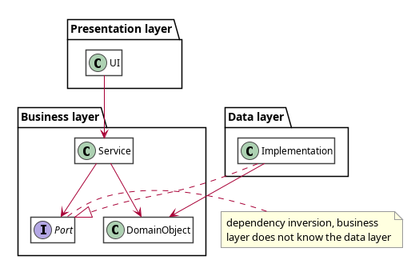</a></td>
<td><a href="docs/diagrams/patterns/layers-actual.svg">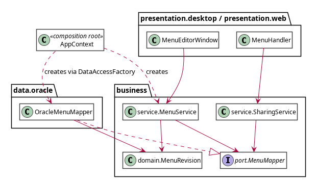</a></td>
</tr>
</table>

### Domain Model

Source: Fowler, PoEAA. Business rules live in the domain classes. For example MenuRevision checks that it may be edited and validates the menu content, Project refuses changes when archived.

| Role | Class in the code |
|---|---|
| Rich domain object | MenuRevision, Project, Customer, User, Product, ShareLink |
| Rules without state | AccessPolicy |
| Thin coordinator | MenuService, ProjectService |

<table>
<tr><th>Textbook structure</th><th>In this code</th></tr>
<tr>
<td><a href="docs/diagrams/patterns/domain-model-abstract.svg">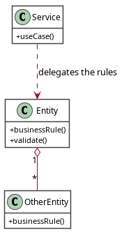</a></td>
<td><a href="docs/diagrams/patterns/domain-model-actual.svg">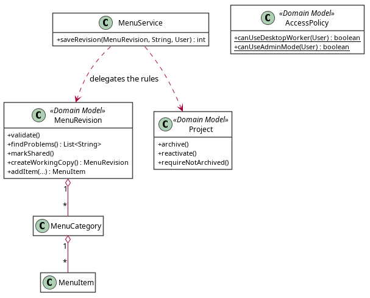</a></td>
</tr>
</table>

### Layer Supertype

Source: Fowler, PoEAA. Common identifier and isNew() for all entities, so mappers can decide between insert and update.

| Role | Class in the code |
|---|---|
| Layer Supertype | DomainObject |
| Subtypes | ProjectNode, Project, Customer, User, Product, Comment, ShareLink, MenuCategory |

<table>
<tr><th>Textbook structure</th><th>In this code</th></tr>
<tr>
<td><a href="docs/diagrams/patterns/layer-supertype-abstract.svg">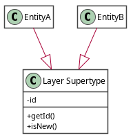</a></td>
<td><a href="docs/diagrams/patterns/layer-supertype-actual.svg">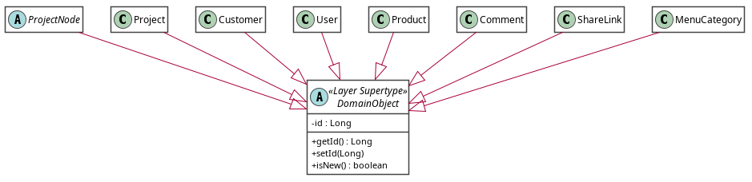</a></td>
</tr>
</table>

### Value Object

Source: Fowler, PoEAA. Immutable amounts compared by value. Every operation returns a new Money, so prices cannot be changed by accident.

| Role | Class in the code |
|---|---|
| Value Object | Money |
| Users | MenuItem, Product, PriceStrategy implementations |

<table>
<tr><th>Textbook structure</th><th>In this code</th></tr>
<tr>
<td><a href="docs/diagrams/patterns/value-object-abstract.svg">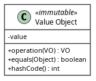</a></td>
<td><a href="docs/diagrams/patterns/value-object-actual.svg">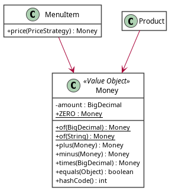</a></td>
</tr>
</table>

### Service Layer

Source: Fowler, PoEAA. One service method is one step of a use case. It opens the transaction, calls the mappers and the domain objects and returns the result to the UI.

| Role | Class in the code |
|---|---|
| Service Layer | MenuService, SharingService, ProjectService, DocumentService, AuthService, UserService, CustomerService, CatalogService, MenuExportService |
| Clients | windows in presentation.desktop, handlers in presentation.web |

<table>
<tr><th>Textbook structure</th><th>In this code</th></tr>
<tr>
<td><a href="docs/diagrams/patterns/service-layer-abstract.svg">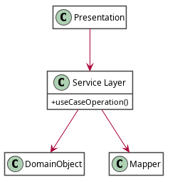</a></td>
<td><a href="docs/diagrams/patterns/service-layer-actual.svg">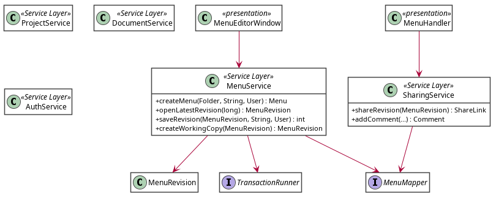</a></td>
</tr>
</table>

### Data Mapper

Source: Fowler, PoEAA. Domain objects know nothing about SQL. The mappers translate between rows and objects, the services see only the port interfaces.

| Role | Class in the code |
|---|---|
| Domain object | Project, MenuRevision, User, ... |
| Mapper interface | business.port.*Mapper |
| Mapper | data.oracle.Oracle*Mapper |
| Database access | Jdbc, Database |

<table>
<tr><th>Textbook structure</th><th>In this code</th></tr>
<tr>
<td><a href="docs/diagrams/patterns/data-mapper-abstract.svg">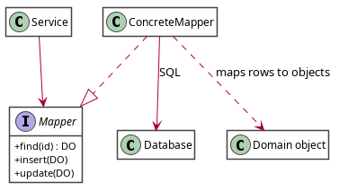</a></td>
<td><a href="docs/diagrams/patterns/data-mapper-actual.svg">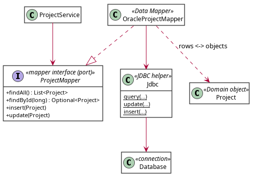</a></td>
</tr>
</table>

### Identity Field

Source: Fowler, PoEAA. Entities keep the primary key in id. After an INSERT the mapper stores the generated key in the object. MenuRevision is identified by (menuId, revisionNo).

| Role | Class in the code |
|---|---|
| Identity field | DomainObject.id |
| Key generation | Jdbc.insert, Oracle*Mapper.insert |

<table>
<tr><th>Textbook structure</th><th>In this code</th></tr>
<tr>
<td><a href="docs/diagrams/patterns/identity-field-abstract.svg">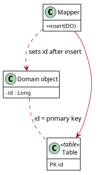</a></td>
<td><a href="docs/diagrams/patterns/identity-field-actual.svg">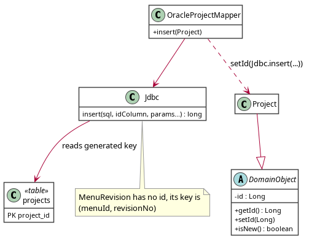</a></td>
</tr>
</table>

### Foreign Key Mapping

Source: Fowler, PoEAA. A reference to another object is a foreign key column. The mapper joins the tables and builds the whole object graph.

| Role | Class in the code |
|---|---|
| Referencing object | Project, MenuItem |
| Referenced object | Customer, Product |
| Mapper | OracleProjectMapper, OracleMenuMapper |

<table>
<tr><th>Textbook structure</th><th>In this code</th></tr>
<tr>
<td><a href="docs/diagrams/patterns/foreign-key-mapping-abstract.svg">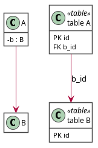</a></td>
<td><a href="docs/diagrams/patterns/foreign-key-mapping-actual.svg">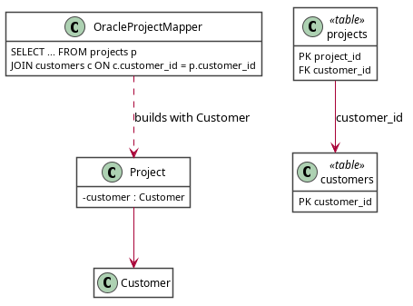</a></td>
</tr>
</table>

### Association Table Mapping

Source: Fowler, PoEAA. Many to many relations are stored in link tables and loaded into a collection of the owning object.

| Role | Class in the code |
|---|---|
| M:N object pair | User and Role, Product and Allergen |
| Association table | user_roles, product_allergens |
| Mapper | OracleUserMapper, OracleProductMapper |

<table>
<tr><th>Textbook structure</th><th>In this code</th></tr>
<tr>
<td><a href="docs/diagrams/patterns/association-table-mapping-abstract.svg">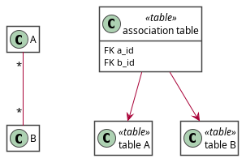</a></td>
<td><a href="docs/diagrams/patterns/association-table-mapping-actual.svg">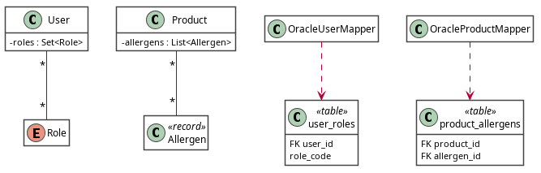</a></td>
</tr>
</table>

### Dependent Mapping

Source: Fowler, PoEAA. Categories and items have no mapper of their own. OracleMenuMapper saves and loads them together with the revision.

| Role | Class in the code |
|---|---|
| Owner | MenuRevision |
| Dependents | MenuCategory, MenuItem |
| Mapper of the owner | OracleMenuMapper (insertContent) |

<table>
<tr><th>Textbook structure</th><th>In this code</th></tr>
<tr>
<td><a href="docs/diagrams/patterns/dependent-mapping-abstract.svg">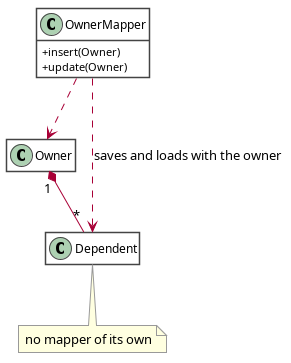</a></td>
<td><a href="docs/diagrams/patterns/dependent-mapping-actual.svg">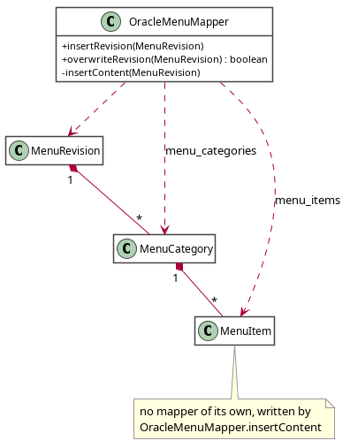</a></td>
</tr>
</table>

### Single Table Inheritance

Source: Fowler, PoEAA. The whole project tree lives in one table, which makes the recursive tree query simple.

| Role | Class in the code |
|---|---|
| Base class | ProjectNode |
| Subclasses | Folder, Document, Menu |
| Table and discriminator | project_nodes.node_type |
| Mapper | OracleProjectNodeMapper |

<table>
<tr><th>Textbook structure</th><th>In this code</th></tr>
<tr>
<td><a href="docs/diagrams/patterns/single-table-inheritance-abstract.svg">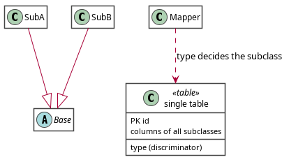</a></td>
<td><a href="docs/diagrams/patterns/single-table-inheritance-actual.svg">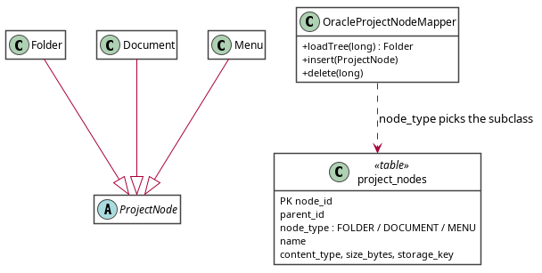</a></td>
</tr>
</table>

### Lazy Load

Source: Fowler, PoEAA. Comments of a revision and product photos are read from the database only when first needed.

| Role | Class in the code |
|---|---|
| Object with a loader | MenuRevision (commentLoader) |
| Loader supplier | OracleMenuMapper.findComments |
| Second case | ProductMapper.loadPhoto |

<table>
<tr><th>Textbook structure</th><th>In this code</th></tr>
<tr>
<td><a href="docs/diagrams/patterns/lazy-load-abstract.svg">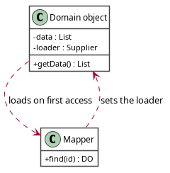</a></td>
<td><a href="docs/diagrams/patterns/lazy-load-actual.svg">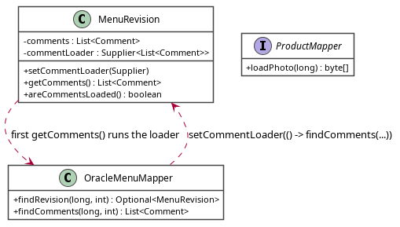</a></td>
</tr>
</table>

### Gateway

Source: Fowler, PoEAA. The second storage, documents on disk, is hidden behind one interface. Services do not touch the file system.

| Role | Class in the code |
|---|---|
| Gateway interface | DocumentStorage |
| Gateway implementation | FileDocumentStorage |
| Client | DocumentService |

<table>
<tr><th>Textbook structure</th><th>In this code</th></tr>
<tr>
<td><a href="docs/diagrams/patterns/gateway-abstract.svg">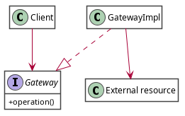</a></td>
<td><a href="docs/diagrams/patterns/gateway-actual.svg">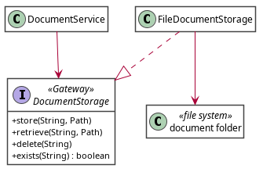</a></td>
</tr>
</table>

### Service Stub

Source: Fowler, PoEAA. Tests of services run without a document folder on disk.

| Role | Class in the code |
|---|---|
| Gateway | DocumentStorage |
| Stub | InMemoryDocumentStorage |
| Client in tests | DocumentServiceTest, MenuExportServiceTest |

<table>
<tr><th>Textbook structure</th><th>In this code</th></tr>
<tr>
<td><a href="docs/diagrams/patterns/service-stub-abstract.svg">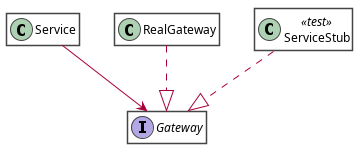</a></td>
<td><a href="docs/diagrams/patterns/service-stub-actual.svg">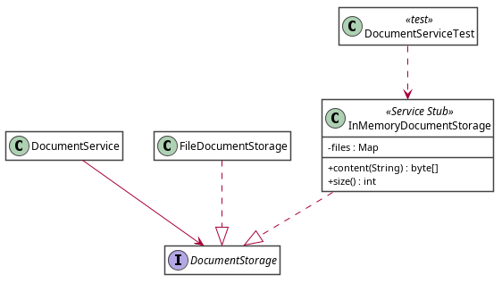</a></td>
</tr>
</table>

### Special Case

Source: Fowler, PoEAA. A token that is not in the database becomes UnknownShareLink, so the code does not check for null.

| Role | Class in the code |
|---|---|
| Base type | ShareLink |
| Special case | UnknownShareLink |
| Client | SharingService |

<table>
<tr><th>Textbook structure</th><th>In this code</th></tr>
<tr>
<td><a href="docs/diagrams/patterns/special-case-abstract.svg">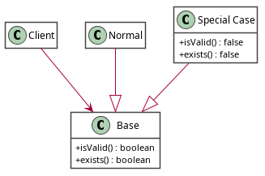</a></td>
<td><a href="docs/diagrams/patterns/special-case-actual.svg">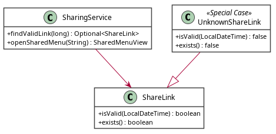</a></td>
</tr>
</table>

### Optimistic Offline Lock (simplified)

Source: Fowler, PoEAA. Saving a working revision succeeds only when the saved time in the database is still the one loaded. There is no version column.

| Role | Class in the code |
|---|---|
| Version | MenuRevision.getLoadedSavedAt (time of the last save) |
| Check | OracleMenuMapper.overwriteRevision, markShared |
| Conflict | ConflictException, thrown by MenuService |

<table>
<tr><th>Textbook structure</th><th>In this code</th></tr>
<tr>
<td><a href="docs/diagrams/patterns/optimistic-lock-abstract.svg">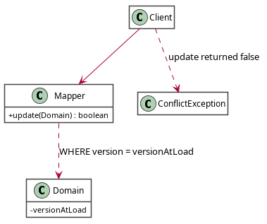</a></td>
<td><a href="docs/diagrams/patterns/optimistic-lock-actual.svg">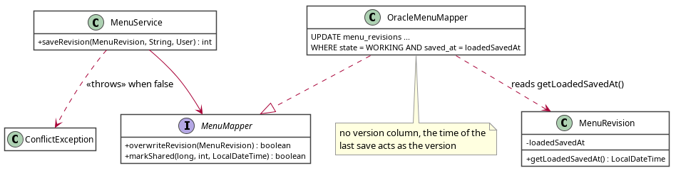</a></td>
</tr>
</table>

### Transaction

Source: Fowler, PoEAA. Each service operation runs in one transaction, with commit at the end and rollback on an exception. Nested calls join the running one.

| Role | Class in the code |
|---|---|
| Port | TransactionRunner |
| Implementation | Database.inTransaction |
| Clients | all *Service classes |

<table>
<tr><th>Textbook structure</th><th>In this code</th></tr>
<tr>
<td><a href="docs/diagrams/patterns/transaction-abstract.svg">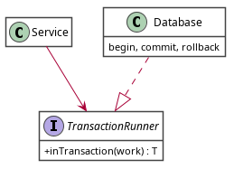</a></td>
<td><a href="docs/diagrams/patterns/transaction-actual.svg">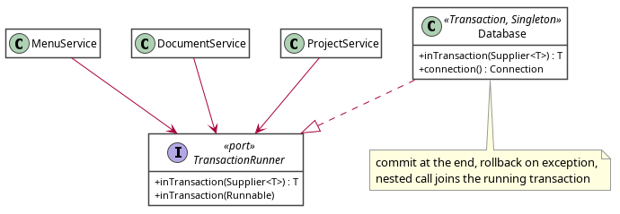</a></td>
</tr>
</table>

### Composite

Source: GoF. The project tree. countDocuments, isDeletable and path are called the same way on a folder and on a leaf.

| Role | Class in the code |
|---|---|
| Component | ProjectNode |
| Leaf | Document, Menu |
| Composite | Folder |
| Client | DocumentService |

<table>
<tr><th>Textbook structure</th><th>In this code</th></tr>
<tr>
<td><a href="docs/diagrams/patterns/composite-abstract.svg">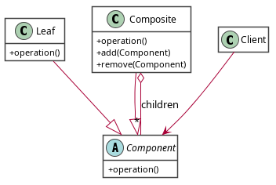</a></td>
<td><a href="docs/diagrams/patterns/composite-actual.svg">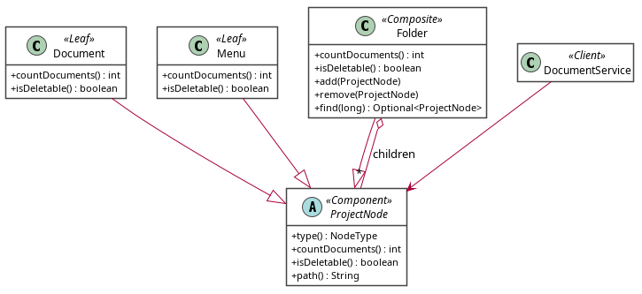</a></td>
</tr>
</table>

### Factory

Source: GoF. The rest of the application does not know which mappers or storage are used. They come from the configuration.

| Role | Class in the code |
|---|---|
| Factory | DataAccessFactory |
| Products | port interfaces (MenuMapper, DocumentStorage, ...) |
| Concrete products | Oracle*Mapper, FileDocumentStorage, PdfMenuRenderer |
| Client | AppContext |

<table>
<tr><th>Textbook structure</th><th>In this code</th></tr>
<tr>
<td><a href="docs/diagrams/patterns/factory-abstract.svg">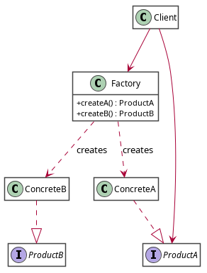</a></td>
<td><a href="docs/diagrams/patterns/factory-actual.svg">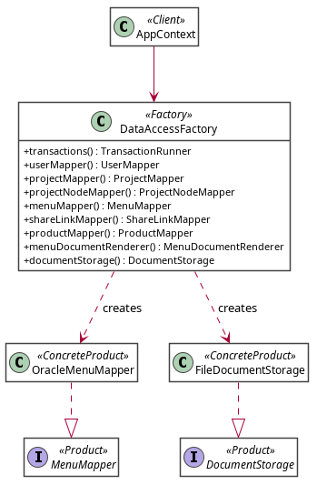</a></td>
</tr>
</table>

### Factory Method

Source: GoF. createIn does the common steps (name check, adding to the folder), the subclasses decide which node is created.

| Role | Class in the code |
|---|---|
| Creator | NodeCreator (createIn) |
| Concrete creators | FolderCreator, MenuCreator, DocumentCreator |
| Product | ProjectNode |
| Concrete products | Folder, Menu, Document |
| Clients | DocumentService, MenuService |

<table>
<tr><th>Textbook structure</th><th>In this code</th></tr>
<tr>
<td><a href="docs/diagrams/patterns/factory-method-abstract.svg">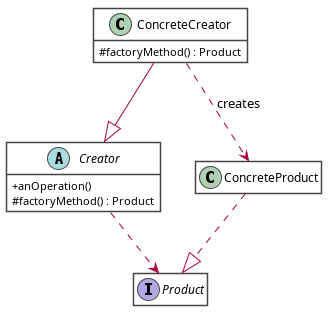</a></td>
<td><a href="docs/diagrams/patterns/factory-method-actual.svg">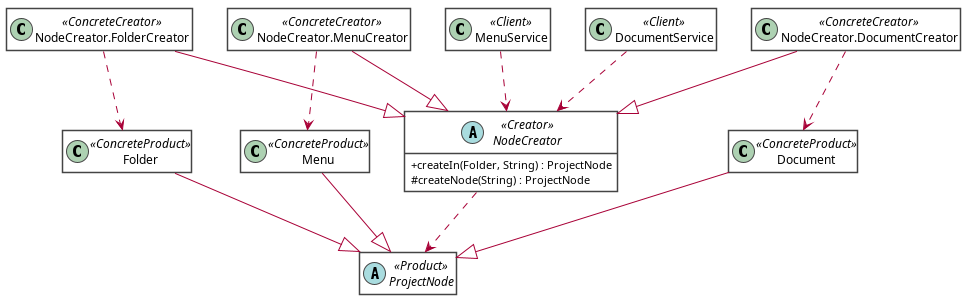</a></td>
</tr>
</table>

### Singleton

Source: GoF. There is one connection owner for the whole application. DataAccessFactory initialises it at start-up.

| Role | Class in the code |
|---|---|
| Singleton | Database |
| Instance creation | Database.init |
| Access | Database.getInstance (Jdbc, OracleMenuMapper) |

<table>
<tr><th>Textbook structure</th><th>In this code</th></tr>
<tr>
<td><a href="docs/diagrams/patterns/singleton-abstract.svg">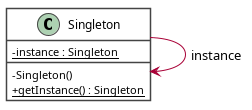</a></td>
<td><a href="docs/diagrams/patterns/singleton-actual.svg">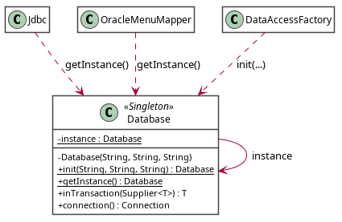</a></td>
</tr>
</table>

### Facade

Source: GoF. The UI calls one simple method and the service coordinates mappers, transaction and domain objects.

| Role | Class in the code |
|---|---|
| Facade | MenuService (and the other *Service classes) |
| Subsystem | MenuMapper, ProjectNodeMapper, TransactionRunner, domain objects |
| Client | MenuEditorWindow |

<table>
<tr><th>Textbook structure</th><th>In this code</th></tr>
<tr>
<td><a href="docs/diagrams/patterns/facade-abstract.svg">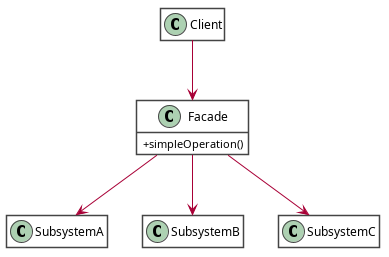</a></td>
<td><a href="docs/diagrams/patterns/facade-actual.svg">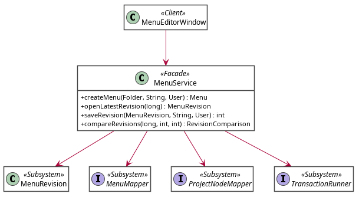</a></td>
</tr>
</table>

### Strategy

Source: GoF. The user switches between prices with and without VAT in the editor and on the customer web.

| Role | Class in the code |
|---|---|
| Context | MenuItem (price) |
| Strategy | PriceStrategy |
| Concrete strategies | PriceWithoutVat, PriceWithVat |
| Chooser | MenuEditorWindow, MenuPage (?dph=1) |

<table>
<tr><th>Textbook structure</th><th>In this code</th></tr>
<tr>
<td><a href="docs/diagrams/patterns/strategy-abstract.svg">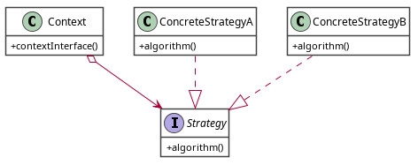</a></td>
<td><a href="docs/diagrams/patterns/strategy-actual.svg">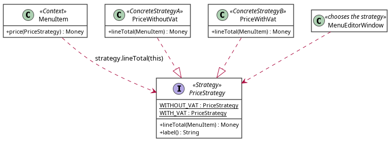</a></td>
</tr>
</table>

### Observer

Source: GoF. After each change of the revision the editor refreshes the table and the totals.

| Role | Class in the code |
|---|---|
| Subject | MenuRevision |
| Observer | MenuRevisionListener |
| Concrete observer | MenuEditorWindow (listener lambda) |

<table>
<tr><th>Textbook structure</th><th>In this code</th></tr>
<tr>
<td><a href="docs/diagrams/patterns/observer-abstract.svg"></a></td>
<td><a href="docs/diagrams/patterns/observer-actual.svg"></a></td>
</tr>
</table>

### Command

Source: GoF. Each menu edit is an object, so MenuEditor can keep a stack and undo it (the Zpět button).

| Role | Class in the code |
|---|---|
| Client | MenuEditorWindow |
| Invoker | MenuEditor |
| Command | MenuEditCommand |
| Concrete commands | AddItemCommand, ChangeItemCommand, RemoveItemCommand, AddCategoryCommand, RemoveCategoryCommand |
| Receiver | MenuRevision |

<table>
<tr><th>Textbook structure</th><th>In this code</th></tr>
<tr>
<td><a href="docs/diagrams/patterns/command-abstract.svg"></a></td>
<td><a href="docs/diagrams/patterns/command-actual.svg"></a></td>
</tr>
</table>

## Documentation

The semester project artefacts are in `projekt/docs/artefacts`:

- A5 Domain model design (class diagrams, sequence diagrams, patterns)
- A6 Architecture (components, deployment, installation)
- A7 Implementation (use case demos, storages, tests, build and run)
