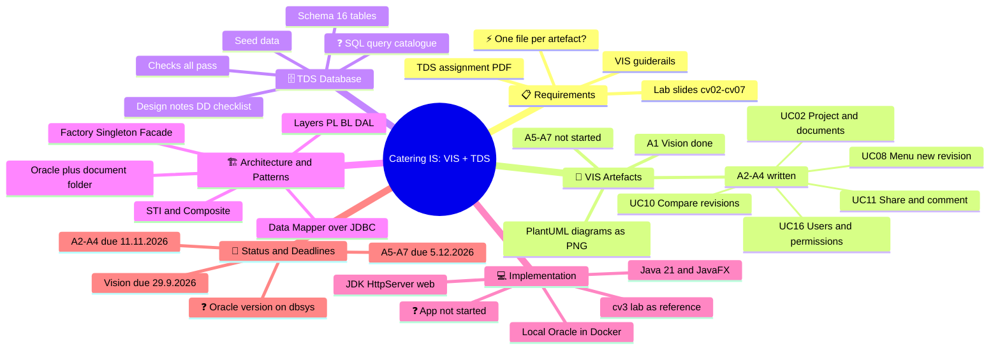

# Map: Catering IS (VIS + TDS)

Paths are relative to `/home/jan/Documents/VSB/tretak/`. ❓ = open gap, ⚡ = contradiction
(details in `OPEN-QUESTIONS.md`).

Plain tree (same content):

- 📋 Requirements: VIS guiderails · lab slides cv02–cv07 · TDS assignment PDF · ⚡ one file per artefact?
- 📄 VIS Artefacts: A1 done · A2–A4 written (UC02, UC08, UC10, UC11, UC16) · A5–A7 not started · PlantUML diagrams as PNG
- 🗄️ TDS Database: schema 16 tables · seed data · checks pass · design notes · ❓ SQL query catalogue
- 🏗️ Architecture and Patterns: layers · Data Mapper over JDBC · STI + Composite · Factory, Singleton, Facade · Oracle + document folder
- 💻 Implementation: Java 21 + JavaFX · JDK HttpServer web · local Oracle in Docker · cv3 as reference · ❓ app not started
- 📅 Status and Deadlines: Vision 29.9.2026 · A2–A4 11.11.2026 · A5–A7 5.12.2026 · ❓ Oracle version on dbsys

## Where is what

| Node | Path |
|---|---|
| VIS guiderails | `VIS/projekt/guiderails.md` (digest: `REQ-VIS.md`) |
| Lab slides | `VIS/presentations/VIS_cv02.pdf` … `VIS_cv07.pdf` |
| TDS assignment PDF | `VIS/projekt/Semestrální projekt TDS I.pdf` (digest: `REQ-TDS.md`) |
| A1 Vision | `VIS/projekt/docs/artefacts/a1-vize.tex` |
| A2 functional spec (UCs) | `VIS/projekt/docs/artefacts/a2-funkcni-specifikace.tex` |
| A3 technical spec | `VIS/projekt/docs/artefacts/a3-technicka-specifikace.tex` |
| A4 UI sketches | `VIS/projekt/docs/artefacts/a4-skica-ui.tex` |
| Shared LaTeX preamble, title page | `VIS/projekt/docs/artefacts/preamble.tex` |
| Hand-in A2–A4 | `VIS/projekt/docs/artefacts/VIS_ZAM0074_C06_A234.tex` → `.pdf` |
| Full documentation | `VIS/projekt/docs/artefacts/main.tex` → `main.pdf` |
| Original Vision before the split | `VIS/projekt/docs/artefacts/main.tex.bak-2026-10-29` |
| PlantUML diagrams | `VIS/projekt/docs/artefacts/diagrams/*.puml` (style `common.iuml`) |
| Schema | `TDS/db/01_schema.sql` |
| Seed data | `TDS/db/02_seed.sql` |
| Checks | `TDS/db/03_checks.sql` |
| Design notes (DD checklist) | `TDS/db/tds-design-notes.md` |
| Local Oracle in Docker | `TDS/db/README-local-oracle.md` |
| cv3 lab (reference only) | `VIS/cv3/` |
| Decisions / status / open questions | `VIS/projekt/notes/DECISIONS.md`, `STATUS.md`, `OPEN-QUESTIONS.md` |
